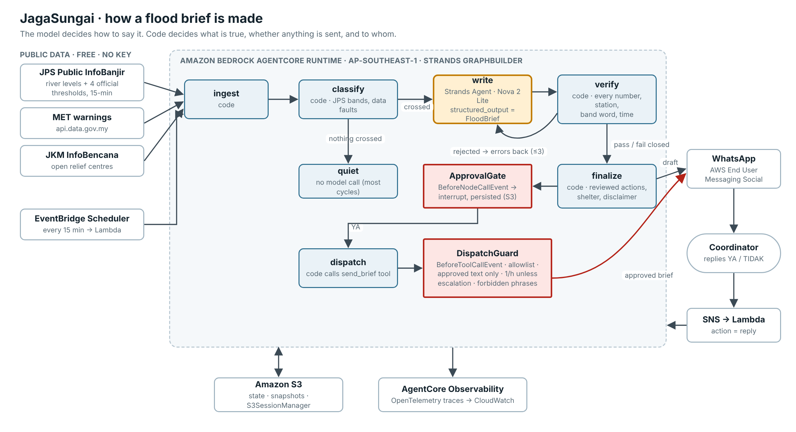

# JagaSungai: verified flood briefs for cut-off communities

**JagaSungai** ("river watch" in Malay) is an agent built with the [Strands Agents SDK](https://strandsagents.com) that watches the upstream river gauges a specific community depends on. When a gauge crosses an official JPS (Department of Irrigation and Drainage) threshold, it drafts a plain Bahasa Melayu / English "what is happening, what to do now" brief and checks every number in it against the readings. It then waits for the community coordinator to approve the brief before sending it over WhatsApp.

> Built for the AWS Builder Center hackathon **Strands SDK: Workshop to Ship** (focus area: *Climate resilience*).
> Licence: Apache-2.0.



**The design rule:** the model decides *how to say it*, and code decides *what is true, whether anything is sent, and to whom*.

---

## The problem, and who has it

Kelantan's Gua Musang district is home to roughly 10,000 Temiar Orang Asli across Pos Tohoi, Pos Bihai, Pos Belatim, Pos Balar, Pos Gob, Pos Simpor and Kuala Betis. In flood season the road to these posts is cut by landslides and high water ([Malaysiakini](https://m8.malaysiakini.com/en/news/691240)). In December 2025, floods displaced more than 1,000 Orang Asli across five Gua Musang villages ([Malay Mail](https://malaymail.com/news/malaysia/2025/12/17/floods-affect-over-1000-orang-asli-across-five-gua-musang-villages-in-kelantan/202276)). Nationally, the 2024–25 monsoon displaced 40,922 families into 633 relief centres ([ReliefWeb](https://reliefweb.int/disaster/fl-2024-000218-mys)).

The data to warn these communities is already public. JPS publishes every gauge every 15 minutes, with four official thresholds per station (Normal, Waspada/Alert, Amaran/Warning, Bahaya/Danger), on [Public InfoBanjir](https://publicinfobanjir.water.gov.my/waterleveldata/Kelantan). But that is a table of 28 stations and numbers, not a decision. Whoever still has signal (a JAKOA officer, a Tok Batin, an NGO volunteer) has to read it, know which upstream gauge matters, and turn it into instructions people will act on.

When this project was built, the live table also showed why that interpretation is hard. On 1 Nov 2026 at 00:45, **two of the four gauges that matter for Gua Musang were unusable**: Sg. Galas di Kg. Pulai reported `-9,999.00` (sensor fault), and Sg. Nenggiri di Bertam had placeholder thresholds of `310 / 315 / 320 m`. Six other Kelantan stations had the same placeholder problem (7 of 28 in total). A system that reads such a table naively would either cry wolf or report "normal" for a gauge that is not measuring anything.

## What the coordinator gets

When the river is quiet, nothing happens and no model is called. When Sg. Galas di Kg. Lembaga crosses Amaran, the coordinator receives a draft like this (real thresholds; level from the replay scenario):

```
*JagaSungai · 03/11 10:05*
Kuala Betis & pos-pos Orang Asli, Gua Musang: paras tertinggi Amaran di Sg. Galas di Kg. Lembaga (F1)

• Sg. Nenggiri di Bertam (F1): tiada data boleh dipercayai (tiada paras ambang sah).
• Sg. Galas di Limau Kasturi: 57.20 m, tahap Waspada. 2.80 m lagi ke Amaran.
• Sg. Galas di Kg. Pulai (F1): tiada data boleh dipercayai (sensor rosak).
• Sg. Galas di Kg. Lembaga (F1): 86.10 m, tahap Amaran. 1.80 m lagi ke Bahaya.

*Tindakan:*
1. Bersedia untuk berpindah. Bawa warga emas, OKU dan kanak-kanak ke tempat tinggi dahulu.
2. Jangan menyeberang sungai atau jalan yang dinaiki air.
3. Hubungi pegawai daerah / JKM untuk status PPS dan pengangkutan.

PPS terdekat (profil): PPS contoh A (ganti dengan senarai JKM), ~1.4 km

Ringkasan JagaSungai berdasarkan bacaan tolok JPS awam. Bukan amaran rasmi; ikut arahan pihak berkuasa.
https://publicinfobanjir.water.gov.my/waterleveldata/Kelantan
```

They reply **YA** to send it to the community list, or **TIDAK** to drop it. Broken gauges are reported as "no reliable data" and never as "normal".

## Social impact

| Metric | Result | How it is measured |
|---|---|---|
| Band classification on real JPS thresholds, including every live data fault | **77/77** | `evals/eval_classify.py` |
| Injected hallucinations stopped before reaching a coordinator | **33/33** | `evals/eval_verifier.py` |
| Correct paraphrases accepted (the verifier does not block everything) | **5/5** | `evals/eval_verifier.py` |
| Attacks on the send path blocked (unlisted numbers, unapproved, altered or stale drafts, rate abuse, prompt injection, compromised model) | **32/32** | `evals/eval_redteam.py` |
| 48 h replay: every band escalation (Waspada → Amaran → Bahaya) delivered | **yes**, same 15-min cycle as the crossing; delivered 5 min later after simulated approval | `evals/eval_replay.py` |
| 48 h replay: cycles that never called a model | **181/192** | `evals/eval_replay.py` |
| Stations that can be onboarded by adding a YAML profile, no code | any InfoBanjir station (Kelantan page: 28) | `profiles/*.yaml` |

The full table, every attack and every injected error are listed in [`results/EVALS.md`](results/EVALS.md), generated by `python -m evals.run_all`.

What this means for a coordinator: a brief arrives in the 15-minute cycle in which the gauge crosses a threshold. It names the actual stations, is in their language, comes with pre-reviewed actions, and is honest about broken gauges. The coordinator never has to read a 28-row table at 2 a.m. In the replay, the coordinator was asked to approve 11 briefs over 48 hours and was never asked twice in an hour unless the river escalated.

## Technical execution: how it uses Strands Agents

| Strands feature | Where | Why |
|---|---|---|
| `GraphBuilder` with **custom deterministic nodes** (`MultiAgentBase` subclasses) | `jagasungai/graph.py` (`FnNode`) | ingest, classify, verify, finalize and dispatch are code, not prompts |
| **Conditional edges** using `invocation_state` | `graph.py` `build()` | `classify → write` only fires when a threshold is crossed, so most cycles cost nothing |
| **Cycle with `reset_on_revisit`** and an execution cap | `verify → write` | a rejected draft returns to the writer with the exact errors, at most 3 times, then fails closed |
| `Agent(structured_output_model=FloodBrief)` | `jagasungai/writer.py` | the model must return typed fields (station, level, band, text), which can be checked |
| **Graph interrupt** from a `BeforeNodeCallEvent` hook | `jagasungai/guards.py` `ApprovalGate` | the coordinator's approval is part of the graph, not an `if` outside it |
| **`FileSessionManager` / `S3SessionManager`** on the graph | `cli.py` `_session_factory` | the interrupted graph is persisted, and the coordinator's reply resumes it minutes later in another process |
| `BeforeToolCallEvent` hook with `cancel_tool` | `guards.py` `DispatchGuard` | hard boundary on every send: allowlist, approved text only, approval freshness, rate limit with escalation override, forbidden phrases, disclaimer present |
| Direct tool call (`agent.tool.send_brief`) | `graph.py` `_dispatch` | code decides to send, hooks still apply, and no model is in the send path |
| `Model` interface | `jagasungai/scripted_model.py` | a deterministic stand-in lets tests drive the real agent loop, structured output and retries offline |
| `BedrockAgentCoreApp` entrypoint | `agentcore/app.py` | deployed on AgentCore Runtime (ap-southeast-1), polled by EventBridge Scheduler |

### Why a Graph and not a Swarm

A Swarm lets agents decide among themselves who acts next. Here the only decisions that matter are whether a threshold was crossed, whether a draft is true, and whether to send. Those must not be left to a model, so the control flow is a developer-defined graph. The model sits in exactly one node.

### Why not voice (BidiAgent / Nova Sonic)

The coordinators read Bahasa Melayu. At build time Nova Sonic had no Malay voice and ran in four regions, none in Southeast Asia, so text over WhatsApp was the more useful channel.

## Originality: beyond the workshop

The workshop builds a customer-service agent: one agent loop with tools, then hooks, sessions, multi-agent patterns and an AgentCore deploy. JagaSungai keeps those building blocks but changes who is in charge:

* **The LLM is one node of seven.** The other six are deterministic code, and the guards are Strands hooks around them.
* **A verifier loop inside the graph**, with retry feedback and a fail-closed template that is itself verified.
* **Human approval as a persisted graph interrupt** that survives across processes.
* **Hooks as policy, not logging**: every send is re-checked against stored state, whatever called the tool.
* **Real, messy government data**: an HTML scraper with a sentinel, placeholder-threshold and stale-reading detector, written against pages captured live (`fixtures/live/`).
* **A rate limit that understands escalation.** The first version blocked an Amaran → Bahaya escalation inside the hour; the replay eval caught it and the rule was changed (see below).

## Things the evals caught while building

* The first end-to-end run blocked its own message: the code-owned disclaimer "Bukan amaran rasmi" contains the forbidden phrase "amaran rasmi". The guard now scans everything except the disclaimer.
* The verifier's time pattern treated `0.50` as a clock time.
* The rate limit would have suppressed a Bahaya escalation. Escalations now bypass it.
* 18 of 32 drafts in the first replay were approved and then rate-limited, so the coordinator was being asked to approve briefs that could never be sent. The same hourly rule now runs upstream in `classify`, and the guard remains the backstop: **11 drafts, 11 sent**.
* A broken gauge could still be given a level by the model. The verifier now requires `null`.
* While recording the demo, a draft that said Kg. Lembaga was at "tahap Bahaya" (one band too high) was rejected only for its reassurance phrase. "Bahaya" was allowed in that line because the station is "1.80 m to Bahaya". The verifier now checks band *claims* ("tahap X", "X level") against the station's actual band, and three new eval cases cover it.
* Direct calls to the send tool skipped the de-duplication log. Logging moved into the tool itself.

## Try it

```bash
git clone https://github.com/ShermaineYap/Strands-SDK && cd Strands-SDK
python -m venv .venv && . .venv/bin/activate && pip install -r requirements.txt pytest

python -m jagasungai.cli status      # live gauges for Gua Musang right now (no model, no send)
python -m jagasungai.cli demo        # offline: a rise through the full graph, approval, dispatch
python -m evals.run_all              # all evals (~20 s), writes results/EVALS.md
pytest -q                            # 14 tests
```

With AWS credentials (Bedrock access to Amazon Nova in ap-southeast-1):

```bash
export AWS_REGION=ap-southeast-1
python scripts/smoke_bedrock.py                 # one real Nova draft -> verifier -> tokens and cost
python -m jagasungai.cli cycle --model bedrock  # full graph with Nova
python -m jagasungai.cli approve --reply YA
```

Deployment to AgentCore Runtime, the scheduler and WhatsApp: [`docs/DEPLOY.md`](docs/DEPLOY.md).

## Repository map

```
jagasungai/
  sources/infobanjir.py  JPS water level + rainfall parser (tested on live captures)
  sources/met.py         MET warnings (data.gov.my)        sources/jkm.py  JKM open relief centres
  classify.py            JPS bands, data-fault detection, trigger rules     (no model)
  writer.py              the Strands Agent: facts -> FloodBrief             (the only model call)
  verify.py              grounding verifier                                  (no model)
  compose.py             template brief (fail-closed) and final message      (no model)
  actions.py             fixed, reviewable action library + forbidden phrases
  guards.py              ApprovalGate (graph interrupt) + DispatchGuard (tool hook)
  graph.py               the Strands graph
  scripted_model.py      offline Model implementation for tests and evals
profiles/                communities as data (gua_musang.yaml, kuala_krai.yaml)
fixtures/live/           InfoBanjir, MET and JKM pages captured 2026-11-01
evals/                   classification, verifier, red-team, 48 h replay
agentcore/app.py         AgentCore Runtime entrypoint
lambdas/, infra/         scheduler + inbound WhatsApp Lambdas, SAM template
```

## What is real, and disclosures

* **Real:** JPS station IDs, names, thresholds and the data faults in `fixtures/live/` (captured from Public InfoBanjir on 1 Nov 2026); the parsers; the live `status` command; the Strands graph, interrupt, session persistence and hooks; every eval number above (deterministic, reproducible with `python -m evals.run_all`).
* **Simulated:** the coordinator and community personas; relief-centre entries in the profiles (placeholders, to be replaced by the district JKM list); the water levels in the replay scenario (real thresholds, synthetic rise). No JAKOA office, Tok Batin or NGO has adopted this tool.
* **Offline model in evals:** the evals use a deterministic stand-in for the model, so they measure the code's guarantees, which hold whatever the model writes. Nova's own first-pass accuracy, tokens and cost are measured by `scripts/smoke_bedrock.py` and `python -m evals.run_all --bedrock`.
* **Data access:** Public InfoBanjir has no published API or terms for automated access. JagaSungai fetches each state page at most once per 15 minutes with an identifying User-Agent, and the parser is isolated so that an official API can replace it.
* **Not an official warning.** Every message says so. The agent never tells anyone they are safe, never tells anyone not to evacuate, and does not replace JPS, MET, NADMA or district instructions.
* **No resident data is collected.** The only phone numbers are the coordinator's and the broadcast list, which are set as environment variables and never committed.
* **Action wording** follows general flood-preparedness guidance and must be reviewed by the deploying agency.

## Path to adoption

The people who would run JagaSungai are not developers: a district JAKOA office, an NGO already working with Orang Asli communities, or a mosque or village committee with one person who keeps signal during floods. The design is aimed at them:

* **Onboarding a community is a YAML file**: station IDs from InfoBanjir, a coordinator number, the district's relief-centre list. No code changes.
* **Running cost scales with floods, not with time.** Quiet cycles make no model call (181 of 192 in the replay), so most of the year the cost is a scheduler, a few seconds of runtime per cycle, and S3.
* **Nothing is sent without a named human approving it**, which is what a disaster-response agency needs before putting its name near an automated message.
* **It runs in one AWS account.** A non-profit could host it on AWS Social Impact Credits, for one district or many.

## What's next

1. Replace placeholder shelters with the district JKM PPS list and add Amazon Location Service routing.
2. A second language pair (Tamil, Mandarin) using Amazon Translate, with the verifier re-run on the translated text.
3. Coordinator voice notes ("jalan Kuala Betis putus") via Amazon Transcribe `ms-MY` as typed field reports.
4. A pilot with one coordinator during the 2026–27 Northeast Monsoon.

## Data and attribution

Water-level and rainfall data: Jabatan Pengairan dan Saliran Malaysia, Public InfoBanjir. Weather warnings: MET Malaysia via data.gov.my (CC BY 4.0). Relief-centre counts: JKM InfoBencana. JagaSungai is an independent project and is not affiliated with or endorsed by these agencies.
